# Kanvas × Yuno SDK Lite — broken vs. fixed

Kanvas (home goods, Brazil + Mexico) is moving to an embedded one-page checkout on **Yuno SDK Lite (Web)**.
This repo holds two runnable versions side by side:

| App | What it is | URL |
|---|---|---|
| `apps/staging-broken` | Diego's staging code from the brief, **verbatim** (plus minimal shims so it runs). Annotated in [`apps/staging-broken/BUGS.md`](apps/staging-broken/BUGS.md). | http://localhost:5173 (backend :4000) |
| `apps/fixed` | Reference implementation: React + Express, cards + PIX (BR) + OXXO (MX), webhook-driven order status, idempotent payments. | http://localhost:5174 (backend :3000) |
| `tools/mock-yuno` | Local simulator of the Yuno API + Web SDK, used **only** when `YUNO_MODE=mock`. | http://localhost:4500/mock |

## Quick start (mock mode, no credentials needed)

```bash
npm install
npm run setup          # creates .env with YUNO_MODE=mock
npm run dev            # mock Yuno + broken app + fixed app
npm run test:double-click
```

Separate terminals (nicer for recording): `npm run mock`, `npm run broken`, `npm run fixed`.

## Running against the real Yuno sandbox

1. Fill in `.env`: `YUNO_MODE=sandbox`, `YUNO_PUBLIC_KEY`, `YUNO_SECRET_KEY`, `YUNO_ACCOUNT_ID`.
2. Expose the backend so Yuno can reach the webhook:
   ```bash
   brew install cloudflared
   npm run tunnel         # → https://<random>.trycloudflare.com
   ```
3. In the Yuno dashboard, create a webhook for payment events pointing to
   `https://<random>.trycloudflare.com/webhooks/yuno`. Copy its credentials into `.env`
   (`YUNO_WEBHOOK_API_KEY` + `YUNO_WEBHOOK_SECRET`, and/or `YUNO_WEBHOOK_HMAC_SECRET`).
4. Make sure Card, PIX (BR) and OXXO (MX) are enabled for the sandbox account.
5. `npm run fixed`. The backend refuses to start if a credential or the webhook auth is missing — it never falls back to mock silently.

The frontend has no config of its own: it gets `{ mode, publicKey }` from `GET /api/config`. Switching modes = edit `.env` and restart.

## The flow (fixed)

```mermaid
sequenceDiagram
  participant B as Browser (React + SDK)
  participant K as Kanvas backend
  participant Y as Yuno
  B->>K: POST /api/orders {country, SKUs}
  K->>K: price cart server-side, create order + idempotency key
  K->>Y: Create customer + checkout session (secret key)
  K-->>B: checkout_session, methods for BR/MX
  B->>B: initialize(publicKey) → startCheckout → mountCheckoutLite(CARD|PIX|OXXO)
  B->>B: Pay → submitOneTimeTokenForm() (card) / mountCheckoutLite (PIX, OXXO) → SDK returns one-time token
  B->>K: POST /api/orders/:id/payments {oneTimeToken}
  K->>Y: Create payment (X-Idempotency-Key = order key)
  Y-->>K: SUCCEEDED (card) or PENDING + sdk_action_required (PIX/OXXO)
  K-->>B: order status
  B->>B: continuePayment() → PIX QR / OXXO voucher
  Note over B: shopper may close the tab here
  Y->>K: webhook payment.purchase (signed)
  K->>Y: GET /payments/:id (re-read, don't trust payload)
  K->>K: PENDING → PAID (state only moves forward)
```



## Bug → fix map

| # | Broken (staging) | Fixed |
|---|---|---|
| 1 | Secret key in the browser bundle and request headers | Secret only in `apps/fixed/backend/src/yunoClient.js`; the frontend gets the public key from `/api/config`. **Rotate the leaked key.** |
| 2 | Session and payment created from the browser | `POST /api/orders`, `POST /api/orders/:id/payments` (server-to-server) |
| 3 | `loadScript(secret)`: production SDK, never initialized | `loadScript({ env: 'sandbox' })` → `initialize(publicKey)` (`src/yuno/loadSdk.js`) |
| 4 | `startPayment()` before `startCheckout()` | Correct lifecycle in `src/yuno/useYunoCheckout.js` |
| 5 | Session missing `account_id`, `merchant_order_id`, `payment_description` | Full session body (`routes/orders.js`) |
| 6 | `countryCode: 'US'`, only `CARD` mounted | Country from the cart; methods per market (BR: Card+PIX, MX: Card+OXXO) |
| 7 | No `createPayment` callback | The callback sends the one-time token to our backend |
| 8 | No `continuePayment()`; PENDING shown as an error | Called whenever `sdk_action_required` is true; PENDING is a normal state |
| 9 | No webhook, status decided by the browser | Signed webhook → re-read payment from Yuno → state machine; plus a reconcile fallback (`reconcile.js`) |
| 10 | No idempotency → double charge | One idempotency key per order, an order-level lock, retries reuse the same key, button disabled |
| 11 | Backend trusts the client's amount | Server-side catalog prices; the client sends SKUs only |
| 12 | Yuno errors returned as HTTP 200 | Errors mapped to 4xx/5xx and logged |

## Demo script

| Behaviour | How to show it |
|---|---|
| The broken baseline | http://localhost:5173 with DevTools open → secret key in Network; `TypeError` and `ReferenceError` in the log |
| Card approved | http://localhost:5174 → Brazil → Card `4111 1111 1111 1111` → **PAID** (source `api`) |
| Async PIX/OXXO, tab closed | Brazil → PIX → Pay → QR shown, order **PENDING** → close the tab → pay (mock: "Open simulated bank app"; sandbox: Yuno's PIX simulator) → open `/orders/<id>` in a new tab → **PAID** (source `webhook`) |
| Double click → one charge | `npm run test:double-click` (mock) or http://localhost:5174/?demo=double-click (UI guard off, every Pay fires twice) |
| Declined card | `4000 0000 0000 0002` → **FAILED** → "Try again" opens a new attempt (new session, new key) |

Mock test cards: `4111 1111 1111 1111` approves, `4000 0000 0000 0002` declines. In sandbox, use Yuno's published test cards.

## Things to confirm against the real sandbox

The mock follows Yuno's documented contracts. These details only the real sandbox can confirm:

- **Payment-method switching**: calling `mountCheckoutLite()` again on the same instance (vs. re-running `startCheckout`).
- **Idempotency**: Yuno's response when the same key arrives with a different body (a second one-time token). Our order lock prevents that path anyway.
- **PIX data**: whether the SDK asks for the CPF or relies on `customer_payer.document` (we send both).
- **`GET /v1/payments/:id`** response shape: the client handles both the bare object and `{ payment: {...} }`.
- **Simulating settlement**: how to settle PIX/OXXO in sandbox (Yuno's test provider/simulator).
